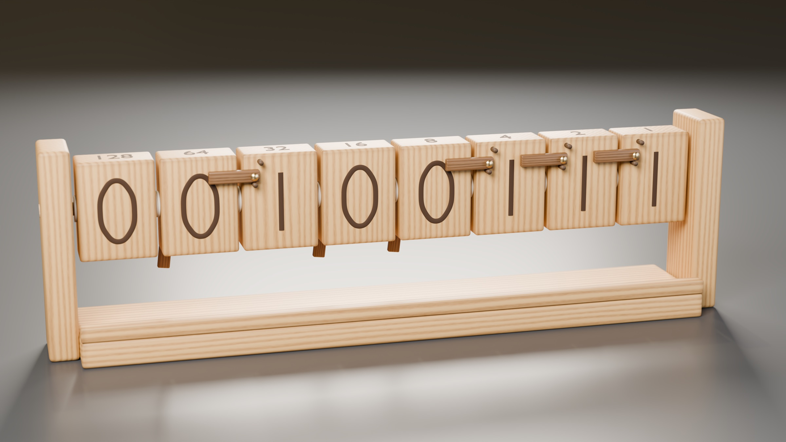
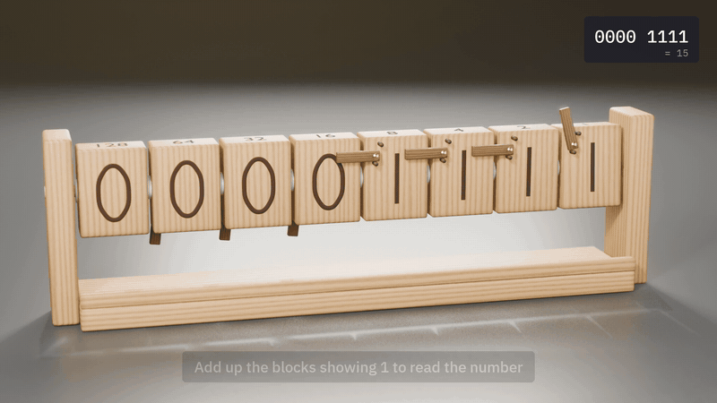
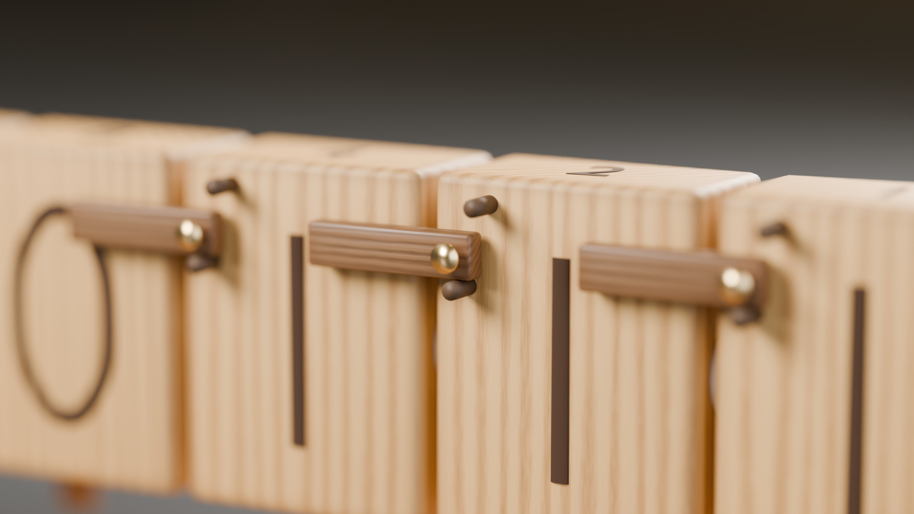

# Mechanical Binary Counter

An interactive 3D model and build guide for an eight-bit wooden binary counter, based on the one Alan Donohoe demonstrates in [this Instagram reel](https://www.instagram.com/reels/DfU1AMuv1Cz/).

**Live page:** https://versantus.github.io/mechanical-binary-counter/

Eight pine blocks hang on a dowel. Each has a 0 on the front, a 1 on the back and its place value (1 to 128) on the top and bottom edges. Every 1 face carries a small walnut gate. When the 1 is at the back, the gate hangs down out of the way. When the block turns over, the gate stands up, falls left and locks across the next block, ready to carry it on the next push.

## Watch it count

The full video ([docs/counter.mp4](docs/counter.mp4), 35 seconds, with sound) counts from 0 to 16 with captions and a live binary readout, and ends with a QR code back to this repo. Click the clip above to watch it.

The stills are ray traced in Blender Cycles. The video is rendered with Blender's EEVEE engine. Both use the same dimensions as the web model and the build guide.

## What's in the page

- **Model:** a 3D counter built with three.js. Push the right-hand block (or press Space) to count, click other blocks to flip them by hand, and drag to turn the model.
- **Rendered:** the same counter with the textures from the ray-traced render baked in (`assets/counter.gltf.json`), lit like the render. Still fully interactive: push, flip, drag and zoom.
- **Build your own:** a parts sheet, a tools list and eight illustrated steps for making a real one.
- **Prompts used:** the prompts used to build this page with Claude Code.

## Running it

Open `index.html` in a browser. It loads three.js r128 from a CDN, so it needs an internet connection.

The build measurements come from the model, not from the original counter. Make one test block and check the gate works before cutting the rest.

---

Made with love by [Versantus](https://versantus.co.uk).
